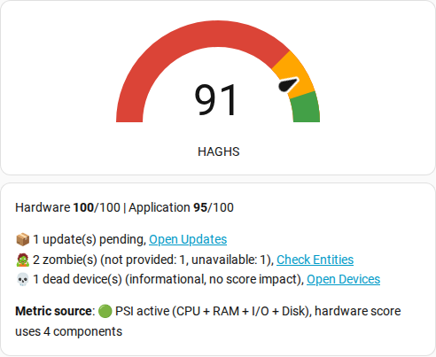
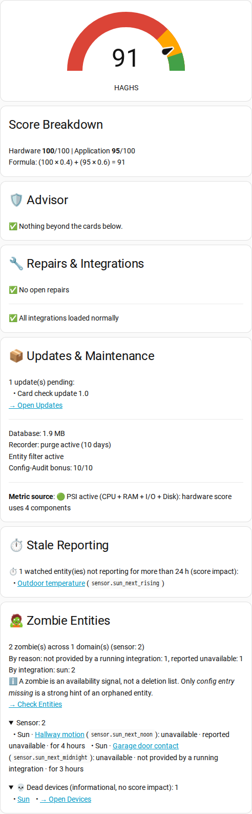

**The open standard for Home Assistant instance health monitoring.**

[](https://github.com/hacs/integration)
[](https://github.com/HA-Pulse/home-assistant-global-health-score/releases)

[](https://github.com/HA-Pulse/home-assistant-global-health-score/stargazers)
[](https://www.buymeacoffee.com/DN91)


---
[](https://sonarcloud.io/summary/new_code?id=HA-Pulse_home-assistant-global-health-score)

## Abstract
As Home Assistant matures into a mission-critical Smart Home OS, the need for a unified stability metric becomes paramount. **HAGHS** is a fully local, open-scoring framework designed to provide an objective **Health Score (0-100)**. It differentiates between transient hardware load and chronic maintenance neglect, providing users with a "North Star" for instance optimization. All scoring logic is fully visible in the codebase, no hidden penalties, no black boxes.

---

## Mission

- **Short-term:** Establish HAGHS as the community standard for Home Assistant instance health monitoring.
- **Long-term:** Propose HAGHS as a native HA Core feature, bringing unified health scoring to every Home Assistant installation by default. With user consent, HAGHS metrics should help the Home Assistant project understand how the software is being used and how healthy instances are across the ecosystem.

---
### Featured In
- [How-To Geek](https://www.howtogeek.com/this-tool-gave-my-home-assistant-server-a-rating-and-told-me-how-to-improve-it/) - *"This tool gave my Home Assistant server a rating (and told me how to improve it)"*
- [XDA Developers](https://www.xda-developers.com/tool-graded-home-assistant-server-told-how-make-better/) - *"This tool graded my Home Assistant server and told me how to make it better"*
- [SmartHütte Podcast](https://www.youtube.com/watch?v=G892ii7YTL8&t=48s) - Episode 30, at 0:48 (German)
- [HomeTech.fm Podcast](https://www.youtube.com/watch?v=IrIW2VR7qic&t=3676s) - Episode 569, at 1:01:16 (English)
- [Simon42 Youtube Video](https://www.youtube.com/watch?v=btd66ndsUuA) - Interview with D-N91, creator of HAGHS (German)
- [Tristans Smartes Heim Youtube Video](https://www.youtube.com/watch?v=oDUdchF1mww&t=20s) - Clean up your Home Assistant (German)
---

### Upgrading

HAGHS v2.3 ships a full `async_migrate_entry` handler that converts config entries from version 1, 2 (any minor), 3.0, 3.1, 3.2, and 3.3 to the current 3.4 layout automatically on the next restart. **No manual remove/re-add is needed**, including for users previously affected by the *"Migration handler not found"* warning on v2.2.x (#75).

---

## Table of Contents
- [The HAGHS Standard](#the-haghs-standard)
- [Pillar 1: Hardware Performance (40%)](#pillar-1-hardware-performance-40)
- [Pillar 2: Application Hygiene (60%)](#pillar-2-application-hygiene-60)
- [Configuration](#configuration)
  - [Prerequisites](#1-prerequisites)
  - [Installation & Setup](#2-installation--setup)
  - [Options Flow](#3-options-flow-runtime-settings)
  - [External Database](#external-database-mariadb)
- [Label Configuration](#label-configuration-smart-whitelisting)
- [Sensor Attributes](#sensor-attributes)
- [Roadmap](#roadmap)
- [UI Integration](#ui-integration)
  - [HAGHS Lite](#haghs-lite-v13-quick-check)
  - [HAGHS Pro](#haghs-pro-v13-command-center)
- [FAQ](#faq)
- [Changelog](#changelog)

---

## The HAGHS Standard

The index is calculated via a weighted average of two core pillars, prioritizing long-term software hygiene over temporary hardware fluctuations.

### The Global Formula

$$Score_{Global} = \lfloor (Score_{Hardware} \cdot 0.4) + (Score_{Application} \cdot 0.6) \rfloor$$

*Note: We use **Floor Rounding** (Integer) to ensure a "Perfect 100" is only achieved by truly optimized systems. Even a minor penalty will drop the score to 99.*

---

## Pillar 1: Hardware Performance (40%)

Evaluates the physical constraints of the host machine using real system metrics. The hardware score is the average of all available component scores (CPU, RAM, I/O, Disk).

* **Metric Source (Smart Fallback):** HAGHS reads **Pressure Stall Information (PSI)** directly from the Linux kernel (`/proc/pressure/cpu`, `/proc/pressure/memory`, `/proc/pressure/io`) for high-precision measurements. If PSI is unavailable (Windows, older Docker, non-Linux hosts), it automatically falls back to the manually configured CPU/RAM sensors. PSI measures real *stall time* (how long tasks waited for a resource), while classic sensors measure *utilization* (how busy a resource is). Because these scales differ fundamentally, HAGHS uses **separate threshold tiers** for each source.

<details>
<summary><b>Penalty tier tables</b> - exact thresholds for CPU, RAM, and I/O</summary>

* **CPU Load (Tiered):**

  | | Classic Sensor (Utilization) | PSI (Stall Time) |
  |---|---|---|
  | No penalty | 0–25% | 0–5% |
  | Light (10 pts) | 26–40% | 6–15% |
  | Medium (25 pts) | 41–60% | 16–30% |
  | Heavy (50 pts) | 61–80% | 31–50% |
  | Critical (80 pts) | >80% | >50% |

* **Memory Pressure (Tiered):**

  | | Classic Sensor (Utilization) | PSI (Stall Time) |
  |---|---|---|
  | No penalty | 0–69% | 0–5% |
  | Gradual ramp | 70–89% (linear) | — |
  | Light (10 pts) | — | 6–10% |
  | Medium (25 pts) | — | 11–25% |
  | Heavy (50 pts) | — | 26–40% |
  | Critical (80 pts) | ≥90% | >40% |

* **I/O Pressure (PSI-only):** Only available on systems with PSI support. Measures disk/storage stall time, directly affects recorder writes, automation execution, and restart speed.

  | | PSI I/O (Stall Time) |
  |---|---|
  | No penalty | 0–5% |
  | Light (10 pts) | 6–15% |
  | Medium (25 pts) | 16–30% |
  | Heavy (50 pts) | 31–50% |
  | Critical (80 pts) | >50% |

</details>

  > When PSI I/O is available, the hardware score uses **4 components** (CPU + RAM + I/O + Disk) / 4. Without I/O, it falls back to **3 components** (CPU + RAM + Disk) / 3.

**PSI-aware recommendations:** The advisor text is split into PSI and classic variants for CPU and RAM. On PSI-equipped systems you see "PSI CPU stall time: 12.5%" (the actual blocking time); on fallback systems "CPU utilization: 65%" (the busy-ness). The metric source is always explicit so you know whether you are looking at stalls or load.

**Translatable recommendations:** The advisor texts are translatable. English is built in as the fallback; a `translations/<language>.json` file can override any template, and missing keys automatically fall back to English. Translations: English (built in), Brazilian Portuguese, German.

**Power supply detection (Raspberry Pi):** HAGHS auto-detects `binary_sensor.rpi_power_status` when available and applies a flat **20-point** hardware penalty while under-voltage is reported. Surfaces silent throttling on undersized power supplies that classic CPU sensors cannot see.

* **Storage Integrity (Smart Thresholds):** Disk usage is **auto-detected** via `psutil`, no manual sensor needed. Thresholds adapt to your storage type:
  * **SD-Card / eMMC:** Critical at **<3 GB free**, Warning at **<5 GB free**.
  * **SSD:** Warning at **<10% free** space.

---

## Pillar 2: Application Hygiene (60%)

Measures "maintenance debt", the hidden factors that cause sluggishness, failed backups, and slow restarts. Every point difference below 100 is explained: each deduction and each unearned bonus prints a recommendation line and sets a matching `rec_*` flag.

* **Zombie Entities (Ratio-based, max 20 pts, hard-cap at 99):** Detects entities with `unavailable` or `unknown` state in 22 physical/UI-relevant domains (automations, scripts, etc. are excluded). Penalties scale with the percentage of zombies relative to the entities in the monitored domains. Two **configurable grace periods** prevent false positives: a regular window (default **5 min**) for all zombie-eligible entities and an extended window (default **60 min**) for `device_class: battery` because Zigbee / Homematic radios routinely take longer than 15 minutes to re-poll low-priority devices after a coordinator restart. Both are adjustable in the Options Flow (1–240 min each). **Disabled** entities are silently ignored - toggling *Disable entity* in HA is now an alternative to applying an ignore label. While at least one zombie is reported, the application score is **hard-capped at 99** so the Config-Audit bonus can never mask a real zombie. The `zombie_entities` attribute lists up to **100** entries (16 KB state-machine limit). Entities without an entity-registry entry (YAML-defined templates, Utility Meter, Riemann Sum, ...) are **not** zombies: they are reported separately as *unregistered* (`unregistered_count`, `unregistered_entities`, `unregistered_count_per_domain`) and do **not** affect the score. `zombie_count` and `zombie_count_per_domain` always carry the full totals. A zombie is an availability signal, not proof that an entity is orphaned, unused or safe to delete: a temporary outage, an idle device or an entity that only reports in some operating modes looks the same. Before deleting an entity, check its integration, device and config entry. When `zombie_count` is higher than the 100 listed entries, `zombie_count_per_domain` and `zombie_count_per_integration` show where the rest come from.
  
* **Dead Devices (informational, no score impact):** Flags devices only when all monitored entities in `ZOMBIE_DOMAINS` are `unavailable` beyond their respective grace periods. `unknown` does not count as an outage, and entities outside the monitored domains are excluded. Devices without monitored entities are not flagged. Reported via `dead_device_count`, `dead_devices` and the `rec_dead_devices` flag. Entity-level zombie points stay authoritative, so no second penalty is added. Respects the same ignore labels and patterns.

* **Empty Devices (informational, no score impact):** Flags devices that have no entity at all in the entity registry (disabled entities included), using Home Assistant facts only: the device is not disabled, not a service entry, no other device is connected through it (hubs and bridges are skipped), and its config entry is loaded. Typical leftovers after removing or re-pairing a device. Respects ignore labels on the device and its area; nothing is checked before the zombie grace period has passed after a restart. Reported via `empty_device_count`, `empty_devices` and the `rec_empty_devices` flag (#93).

* **Database Hygiene (Dynamic Limit):** Database size is **auto-detected** for the built-in SQLite database, no manual FileSize sensor or YAML needed. For **external databases** (MariaDB, PostgreSQL), you can configure a custom database size sensor in the setup or options menu (see [External Database](#external-database-mariadb) below). The limit scales with your system: `Limit_MB = 1000 + (Total_Entities × 2.5)`. Example: 200 entities = 1.5 GB limit.
  
* **Updates & Core Age:** Tracks pending updates and lists them by name (e.g., `pending_updates: ["ESPHome 2024.2"]`). To avoid punishing normal user behaviour (most updates land within a few days), pending updates only contribute to the penalty after a **7-day grace period** - the list shows them immediately, only the score is delayed. Each grace-aged update costs **5 pts**, Core lag (≥3 months) adds **20 pts**, capped at **35 pts** total. Update entities respect the same ignore labels and patterns as zombie detection; disabled update entities are excluded automatically.
  
* **Integration Health:** Natively detects integrations stuck in `SETUP_ERROR`, `SETUP_RETRY`, or `FAILED_UNLOAD` via HA's ConfigEntry API, the same states shown as "error" on the Integrations page. Penalty: **5 pts per unhealthy config entry**, capped at **15 pts**. The affected entries are counted in `integration_unhealthy_count` and reported in the recommendations.
  
* **Repairs:** Open repair issues from HA's issue registry cost **5 pts each**, capped at **10 pts**. Counted are only issues that are currently active, not dismissed and owned by another integration; repairs raised by HAGHS itself describe the integration's own prerequisites and are excluded. While any repair is open, the application score is **hard-capped at 99** - the Config-Audit bonus can never mask a broken integration. Count and list are exposed as `repair_count` and `repairs`, the flag is `rec_repairs`. To take a repair out of the score, use HA's native **"Ignore"** action on it (Settings > Repairs); no HAGHS option is needed. Note that a broken backend often raises a repair issue *and* leaves its config entry unhealthy, so one root cause can cost up to **25 pts** together (15 integration health + 10 repairs).
  
* **Backup Health:** A static **30-point deduction** for stale backups.
  
* **Config Audit (Bonus):** Awards up to **+10 points** for good recorder hygiene, purge days configured (+5) and entity filters active (+5). Unearned bonus points are reported in the recommendations and in `rec_config_audit` (meaning "bonus points are missing", not "the configuration is bad").

---

## Configuration

HAGHS is installed via **HACS** and configured via the **UI**

### 1. Prerequisites

Install the built-in **System Monitor** integration via **Settings > Devices & Services > Add Integration** and search for "System Monitor". This is a **native HA integration**, it is not available in HACS.

After adding it, navigate to its entity list and **manually enable** the following two entities (they are disabled by default):
* `sensor.system_monitor_processor_use` (Percentage %)
* `sensor.system_monitor_memory_usage` (Percentage %)

> **Note:** On most Linux-based HA installations (HAOS, Supervised), HAGHS uses PSI data automatically and these sensors are only a safety net. They remain part of the setup flow, required on systems without PSI and optional with it, but may not be actively used for scoring.
> > **If PSI disappears after setup:** Should the kernel stop exposing PSI (e.g. after switching from HAOS to a non-Linux host) and no CPU/RAM fallback sensors are configured, HAGHS surfaces a **Repair flow** in *Settings > System > Repairs* instead of crashing. The flow lets you pick the fallback sensors and resume operation without restarting Home Assistant.

**That's it.** Database size and disk usage are detected automatically. No `configuration.yaml` changes needed.

### 2. Installation & Setup
1.  Download **HAGHS** in **HACS** and **Restart Home Assistant**.
> **Note on HACS installation:** Each release attaches a pre-built `haghs.zip` asset (see the GitHub Releases page) that can be downloaded manually and dropped into `<config>/custom_components/haghs/`. HACS itself installs straight from the repository content.
2.  Go to **Settings > Devices & Services > Integrations > Add Integration** and search for **HAGHS**.
3.  Follow the setup mask:
    * Select your **CPU** and **RAM** sensors (smart PSI fallback - only used if PSI data is not available on your host).
    * Choose your **Storage Type** (SD-Card / SSD / eMMC, default: SD-Card).
    * Select one or more **Ignore labels** (multi-select). The `haghs_ignore` label is created automatically and pre-selected.
    * Optionally fill the **Ignore entity-id patterns** field with glob patterns.
    * Optionally select a **Database Size Sensor** for external databases (see the collapsible block below).

### 3. Options Flow (Runtime Settings)
After setup, go to **Settings > Devices & Services > Integrations > HAGHS > Configure** to adjust:
* CPU / RAM sensors
* Storage type
* **Ignore labels** (multi-select)
* **Ignore entity-id patterns** (glob list)
* **Conditional ignore labels** and **Active while (helper)** (both empty by default) - extra ignore labels that apply only while the selected `input_boolean`, `switch` or `binary_sensor` is `on`, e.g. a vacation mode. Set both or neither. See [Dynamic exclusions via automation](#dynamic-exclusions-via-automation).
* **Exclude integration entries from Integration Health** (multi-select, empty by default). Select individual entries by title, domain and entry ID. Other entries from the same integration remain included.
* **Stale threshold** (1–8760 hours, default: 24) - how long a sensor may stay silent before it is reported as stale (see Stale reporting).
* **Stale watch labels** (multi-select, empty by default) - labels whose entities cost points when they are overdue (see Stale reporting).
* **Database size sensor** (for external databases)
* **Update interval** (10–3600 seconds, default: 60s)
* **Zombie grace period** (1–240 minutes, default: 5) - how long an entity must stay `unavailable` / `unknown` before it counts as a zombie. Lower values make detection more aggressive; higher values mask short outages.
* **Battery-class grace period** (1–240 minutes, default: 60) - extended window for entities with `device_class: battery`. Zigbee / Homematic radios routinely take longer than the regular window to re-poll battery devices, so a longer default avoids false positives. Independent from the regular grace; can be set lower if you do not care about that distinction.

Changes apply immediately, no restart required.

### Excluding individual integration entries

If an integration entry is expected to fail while a device is powered off, select that specific entry in **Exclude integration entries from Integration Health**. For example, excluding one ADB entry does not exclude another ADB entry. Entries remain selectable even if setup failed before any devices or entities were created. The entry ID distinguishes entries with the same name.

Excluded entries no longer contribute to Integration Health's unhealthy count, penalty, recommendation or rec_integration_health flag. Other entries still cost 5 points each, capped at 15. Clear the entire selection to include all entries again; the empty selection persists after restart. Removed entries do not cause errors.

This exclusion only affects Integration Health. Zombie and device detection, update checks and Repairs are separate. Area, device and entity ignore labels are not automatically applied to integration entries. HAGHS does not detect intentional power-off or test network reachability.

<details>
<summary><b>External Database (MariaDB / PostgreSQL)</b> - full SQL-sensor walkthrough</summary>

### External Database (MariaDB)

If you use an **external database** (MariaDB) instead of the built-in SQLite, HAGHS cannot auto-detect the database size. To enable database monitoring for your setup:

**1. Create a SQL sensor (no YAML needed):**

Go to **Settings > Devices & Services > Add Integration > search "SQL"** and fill in:

- **Database URL:** `mysql://USER:PASSWORD@IP_ADDRESS/homeassistant?charset=utf8mb4`
  *(Leave empty if MariaDB is already configured as your Recorder database)*
- **Name:** `MariaDB Size`
- **Query:**
  ```sql
  SELECT ROUND(SUM(data_length + index_length) / 1024 / 1024, 2) AS size_mb
  FROM information_schema.tables
  WHERE table_schema = 'homeassistant';
  ```
  *(Replace `homeassistant` with your actual database name)*
- **Column:** `size_mb`

In **Advanced Options:**

- **Unit of Measurement:** `MB`
- **Device Class:** `Data size`
- **State Class:** `Measurement`

### Alternative (PostgreSQL)

If you use PostgreSQL instead of MariaDB, replace the SQL query with:

```sql
SELECT ROUND(pg_database_size('homeassistant') / 1024.0 / 1024.0, 2) AS size_mb;
```

(Replace `homeassistant` with your actual database name.)

Credit: [@cryptomilk](https://github.com/cryptomilk) in [#82](https://github.com/HA-Pulse/home-assistant-global-health-score/issues/82).


**2. Select the sensor in HAGHS:**

Go to **Settings > Devices & Services > Integrations > HAGHS > Configure** and select your new sensor in the **"Database size sensor (optional)"** field.

> **Note:** If left empty, HAGHS uses the built-in SQLite auto-detection. If you use an external database and do not provide a sensor, the database score will simply be neutral (no penalty, no monitoring). The sensor must report the value in **MB**, not bytes, not GB.

</details>

---

## Label Configuration (Smart Whitelisting)
To prevent false positives from sleeping tablets or seasonal devices, you have three ways to exclude entities from HAGHS scoring - pick whichever feels most natural:

1. **Disable the entity** (*Settings > Devices & Services > Entity > Disable entity*). HAGHS now respects `entity_registry.disabled_by` automatically, so disabled entities never count as zombies or contribute to update penalties. No HAGHS configuration needed.
2. **Apply an ignore label** (described below) for entities you want to keep enabled but exclude from scoring (e.g. vacation devices, tablets that sleep).
3. **Use a glob pattern** (see *Pattern-Based Ignore* further down) for entities without a unique ID, which cannot carry a label.

To use ignore labels:
1.  Go to **Settings > Areas, labels & zones > Labels**.
2.  The `haghs_ignore` label is created automatically during setup. Create additional labels if needed (e.g. `vacation`, `guest_mode`).
3.  Open **Settings > Devices & Services > HAGHS > Configure** and add every label you want HAGHS to honour to the **Ignore labels** field. The field accepts a list, so all listed labels are evaluated.
4.  Assign any of those labels to any **Area**, **Device**, **Entity**, or **Update Entity**.
    * **Pro Tip:** Assigning a label to a **Device** automatically whitelists **all underlying entities** belonging to that specific device.
    * **Area Tip:** An ignore label on an area excludes entities whose effective Home Assistant area is that area. An entity's own area takes precedence over its device's area; entities without their own area inherit the effective device area. Existing entity and device ignore labels remain independent exclusion rules. Area and label changes take effect on the next regular evaluation.
    * **Update Tip:** Labelled update entities are excluded from the update count and penalty.
    * **Note on `hidden_by`:** Hiding an entity from auto-generated dashboards does **not** exclude it from HAGHS. To exclude a hidden entity, disable it or apply an ignore label.

### Dynamic exclusions via automation

Area, device and entity ignore labels do not exclude whole integration entries from Integration Health. Use the separate integration-entry selection in the HAGHS options for that purpose.

**Without Spook: conditional ignore labels.** In the HAGHS options, put a label like
`vacation` into **Conditional ignore labels** and pick a helper (for example
`input_boolean.vacation_mode`) in **Active while (helper)**. While the helper is `on`,
entities, devices and areas with that label are excluded exactly like with a normal
ignore label; when it is `off`, `unavailable`, `unknown` or deleted, they count again.
An automation only switches the helper with a normal Home Assistant action, and HAGHS
updates right after the change. The sensor attribute `conditional_ignore_active` shows
whether the labels currently apply.

```yaml
# Vacation mode on: the conditional ignore labels apply
- alias: HAGHS vacation start
  trigger:
    - platform: time
      at: "08:00:00"
  action:
    - action: input_boolean.turn_on
      target:
        entity_id: input_boolean.vacation_mode
```

**With Spook: switch the label on the entities.** Home Assistant itself has no service
actions for assigning labels. The label actions used below are provided by the
[Spook](https://spook.boo) custom integration. Without Spook, assign or remove the
labels in the UI. List a label like `vacation` in the HAGHS *Ignore labels* field, then
assign/remove it from automations:

```yaml
# Toggle the `vacation` label on a group of entities (requires Spook)
# (use homeassistant.remove_label_from_entity with the same data when vacation ends)
- alias: HAGHS vacation start
  trigger:
    - platform: time
      at: "08:00:00"
  action:
    - action: homeassistant.add_label_to_entity
      data:
        label_id: vacation
        entity_id:
          - light.terrace
          - switch.coffee_machine
          - vacuum.robot
```

For device labels, Spook provides `homeassistant.add_label_to_device` and
`homeassistant.remove_label_from_device` with `label_id` and `device_id`.

HAGHS picks up the change automatically on its next refresh; no reload needed.

### Pattern-Based Ignore (for entities without a unique ID)

Some integrations (e.g. `monitor_docker`, the legacy `torque` sensor) create entities without a unique ID. These exist only in the state machine, have no entity-registry entry, and therefore cannot carry a label. They are reported as *unregistered* (informational only, no score impact, see [Sensor Attributes](#sensor-attributes)) and never counted as zombies.

Open **Settings > Devices & Services > HAGHS > Configure** and fill the **Ignore entity-id patterns** field with one glob pattern per line. Matching entities are excluded from zombie detection, the unregistered listing and update penalties.

Examples:
- `sensor.docker_*` - every Docker monitor sensor
- `sensor.torque_*` - every Torque OBD sensor
- `binary_sensor.test_?` - `binary_sensor.test_1` through `binary_sensor.test_9`

Wildcards `*` and `?` are supported (standard glob syntax). Invalid patterns are logged as a `WARNING` and skipped, so a single typo never disables the rest of the list.

---

### Stale reporting

HAGHS checks when Home Assistant last received a state report, not when the value last changed. Passive checks cover only sensor and binary_sensor entities. The default stale threshold is 24 hours; you can set it from 1 to 8760 whole hours in the integration options. A state is a candidate only after this threshold has been exceeded.

The passive list does not affect your score. To opt in to scoring, select Stale watch labels in the integration options and apply one of those labels directly to each entity that must keep reporting. Watched entities can belong to any domain. Device and area labels do not opt entities in. Ignore rules take priority. Each overdue watched entity costs 5 application points, capped at 10 before the configuration bonus. While a watched entity is overdue, the application score cannot exceed 99. These are explicit project rules, not validated failure probabilities.

The sensor exposes stale_candidate_count and stale_candidates for passive findings in sensor and binary_sensor, stale_watch_count and stale_watch_entities for opted-in findings in any domain, stale_penalty for the raw application deduction, stale_threshold_hours for the active threshold, and rec_stale for the watched-entity recommendation. Both lists are sorted and limited to 100 entity IDs; their counts remain complete. Watched entities outside sensor and binary_sensor appear only in the watched list and count, not in the passive list and count. The two entity-ID lists remain visible as current attributes but are excluded from recorder history; the counts remain recorded.

Unknown, unavailable, disabled, ignored and HAGHS-owned entities are excluded from this check. Entities without registry entries may appear in the passive list only if they belong to sensor or binary_sensor, but cannot opt in through entity labels. Old reports are a reason to investigate, not proof of a broken device: quiet integrations and devices can legitimately stop reporting. Restarts can reset the report timestamp, so HAGHS does not reconstruct downtime across restarts.

Data source: Home Assistant state.last_reported. No recorder queries, external requests or device polling are added.

## Sensor Attributes

HAGHS exposes the following attributes for use in dashboard cards, automations, and templates:

| Attribute | Type | Description |
|---|---|---|
| `hardware_score` | int | Hardware pillar score (0–100), averaged from CPU, RAM, I/O (if PSI), and Disk |
| `application_score` | int | Application pillar score (0–100) |
| `stale_candidate_count` | int | Complete passive count of overdue sensor and binary_sensor entities |
| `stale_candidates` | list | Alphabetically sorted passive entity IDs, capped at 100; current only, excluded from recorder history |
| `stale_watch_count` | int | Complete count of overdue directly labelled watched entities in any domain |
| `stale_watch_entities` | list | Alphabetically sorted overdue watched entity IDs, capped at 100; current only, excluded from recorder history |
| `stale_penalty` | int | Raw application deduction before the configuration bonus, 5 per overdue watched entity, capped at 10 |
| `stale_threshold_hours` | int | Effective reporting threshold in whole hours, default 24 |
| `rec_stale` | bool | An overdue watched entity triggers the reporting recommendation; passive candidates alone do not |
| `zombie_count` | int | Total number of zombie entities (unavailable/unknown past the grace period, with an entity-registry entry) |
| `zombie_entities`| list | Entity IDs of zombies (capped at 100; `zombie_count` carries the full total); current only, excluded from recorder history (`zombie_count` stays in the history) |
| `zombie_count_per_domain` | dict | Per-domain zombie breakdown (e.g. {"sensor": 3, "switch": 1}); always reflects the full count regardless of the list cap |
| `zombie_count_per_integration` | dict | Zombies per integration, keyed by the entity's integration (e.g. {"matter": 12, "mqtt": 40}); always reflects the full count regardless of the list cap; informational, no score impact |
| `zombie_since` | dict | Since when each listed zombie is unavailable/unknown (ISO timestamps, same 100 entries and order as `zombie_entities`); counted from the last HA restart at the earliest, because an earlier time is not reliably known; current only, excluded from recorder history; informational, no score impact |
| `zombie_count_per_reason` | dict | Zombies per reason, keys in ranking order, only reasons that occur (e.g. {"integration_not_loaded": 3, "unavailable": 40}); always reflects the full count regardless of the list cap, the sum equals `zombie_count`; informational, no score impact |
| `zombie_reasons` | dict | Reason per listed zombie (same 100 entries and order as `zombie_entities`), from Home Assistant facts only, first match in this order: `config_entry_missing` (the config entry the entity belonged to no longer exists; **the only strong hint of an orphaned entity**), `integration_not_loaded` (the entry exists but is not loaded; fix the integration, not a reason to delete), `not_provided` (HA only restored the stored state because no running integration provides the entity; not a reason to delete without checking), `unavailable` (the integration runs and reports the entity as unavailable/unknown, often temporary; not a reason to delete); current only, excluded from recorder history |
| `unregistered_count` | int | Number of detected entities without an entity-registry entry (informational only, does not affect the score) |
| `unregistered_entities` | list | Entity IDs of unregistered entities (capped at 100); current only, excluded from recorder history (`unregistered_count` stays in the history) |
| `unregistered_count_per_domain` | dict | Per-domain breakdown of unregistered entities |
| `dead_device_count` | int | Number of devices whose monitored entities in `ZOMBIE_DOMAINS` are all unavailable past their respective grace periods; unknown does not count as an outage (informational, does not affect the score) |
| `dead_devices` | list | Device names (capped at 100); current only, excluded from recorder history (`dead_device_count` stays in the history) |
| `dead_device_ids` | list | Device ids of the listed dead devices, same 100 entries and order as `dead_devices` (for links to each device page); current only, excluded from recorder history |
| `empty_device_count` | int | Number of devices without any entity (disabled entities included), not disabled, not a service, no other device linked through them (hubs), every config entry loaded; informational, no score impact |
| `empty_devices` | list | Names of those devices, sorted, capped at 100; current only, excluded from recorder history (`empty_device_count` stays in the history) |
| `empty_device_ids` | list | Device ids of the listed empty devices, same 100 entries and order as `empty_devices` (for links to each device page); current only, excluded from recorder history |
| `db_size_mb` | float | Current database size in MB (auto-detected for SQLite, or from external DB sensor if configured) |
| `psi_available` | bool | `True` when PSI provides both CPU and memory data. I/O PSI is read independently and may still be present when this is `False`. Disk is always read via `psutil`, never PSI. |
| `recorder_keep_days` | int/null | Configured purge days (null = not set) |
| `recorder_filter_active` | bool | Whether entity filters are active |
| `conditional_ignore_active` | bool | `True` while the conditional ignore labels apply (their helper is `on`); `False` when none are configured or the helper is `off`, unavailable, unknown or missing |
| `integration_unhealthy_count` | int | Number of config entries in `SETUP_ERROR`, `SETUP_RETRY`, or `FAILED_UNLOAD` (source of the Integration Health penalty) |
| `integration_unhealthy_entries` | list | The counted config entries as `domain: title` (bare `domain` when the entry has no title), sorted, capped at 50; entries excluded in the options are not listed; current only, excluded from recorder history (`integration_unhealthy_count` stays in the history) |
| `config_audit_bonus` | int | Earned Config-Audit bonus points (0–10) |
| `repair_count` | int | Number of open repair issues counted toward the score (own domain and dismissed issues excluded) |
| `repairs` | list | `domain/issue_id` entries of the counted repair issues (capped at 50); current only, excluded from recorder history (`repair_count` stays in the history) |
| `pending_updates` | list | Names of pending updates (e.g., `["ESPHome 2024.2"]`). Listed immediately; only counted toward the score after a 7-day grace period; current only, excluded from recorder history (`rec_updates_pending` stays in the history) |
| `recommendations` | string | Advisor recommendations (CPU, RAM, I/O, disk, DB, power, updates, zombies, dead and empty devices, stale reporting, backup, core lag, integration health, config audit, repairs, calculation warnings) |
| `rec_cpu_load` | bool | CPU load (PSI stall or classic utilization) is currently penalised |
| `rec_ram_pressure` | bool | Memory pressure / utilization is currently penalised |
| `rec_io_pressure` | bool | I/O PSI stall time is currently penalised |
| `rec_disk_low` | bool | Disk free space is below the storage-type threshold |
| `rec_db_over_limit` | bool | Database size exceeds the dynamic limit |
| `rec_power_unstable` | bool | RPi under-voltage detected |
| `rec_backup_stale` | bool | `binary_sensor.backups_stale` is on |
| `rec_updates_pending` | bool | At least one non-ignored update entity has been pending past the 7-day grace period |
| `rec_zombie` | bool | At least one zombie entity is reported |
| `rec_core_lag` | bool | HA Core is ≥ 3 months behind the latest release |
| `rec_integration_health` | bool | At least one integration config entry is in an unhealthy state (source of the Integration Health penalty) |
| `rec_config_audit` | bool | Config-Audit bonus points are missing (means "bonus not earned", not "config is bad") |
| `rec_repairs` | bool | At least one open repair issue from another integration is counted |
| `rec_dead_devices` | bool | At least one dead device (all monitored entities in `ZOMBIE_DOMAINS` unavailable past their respective grace periods) is reported; unknown does not count as an outage (informational, no score impact) |
| `rec_empty_devices` | bool | At least one empty device (no entity at all, see `empty_device_count`) is reported; informational, no score impact |
| `pillar_fallback_count` | int | Number of pillar calculations that failed or timed out during the current refresh attempt |
| `pillar_fallbacks` | list | Affected pillars in stable order: `hardware`, then `application`; an empty list means no observed pillar failure in this attempt |
| `update_cycle_failed` | bool | The current update attempt failed outside a guarded pillar calculation; existing numeric results are retained, or neutral values are used on the first update |
| `rec_pillar_fallback` | bool | At least one pillar calculation failed or timed out during the current refresh attempt |
| `rec_update_failed` | bool | The current update attempt failed outside a guarded pillar calculation |

**Calculation failures:** Neutral fallback values are not successful measurements. If a pillar fails or times out, `pillar_fallbacks` names the affected pillar and `recommendations` includes a warning instead of an all-clear message. Both dashboard examples display that recommendation. If the outer update cycle fails, `update_cycle_failed` is set and the existing numeric result is retained, or neutral values are returned on the first update. A successful refresh clears the failure indicators. Score formulas and numeric fallback values are unchanged.

---

## Roadmap

Planned features, declined items, and completed milestones live in [`ROADMAP.md`](./ROADMAP.md). The roadmap follows the HAGHS philosophy: local-only, system-health focus, HA Core compatibility.

---

## UI Integration

HAGHS provides all data as sensor attributes. Dashboard visualization happens entirely in Lovelace, keeping a clean separation between backend (sensor) and frontend (UI).

Below are two ready-to-use card configurations:

Both configurations are wired to the entity ID `sensor.system_ha_global_health_score`. If your sensor has a different ID (the slug depends on the device and entity name), replace it in two places: the `entity:` line of the gauge card and the `` line at the top of each markdown card.

### HAGHS Lite v1.4 (Quick Check)

A compact card for a fast overview, score, sub-scores, and actionable links.



```yaml
type: vertical-stack
cards:
  - type: gauge
    entity: sensor.system_ha_global_health_score
    name: HAGHS
    unit: " "
    needle: true
    severity:
      green: 90
      yellow: 75
      red: 0
  - type: markdown
    content: >
            

       ⚠️ Health Advisor sensor
      is offline ({{ states(e) }}).               
      

      Hardware **{{ hw }}**/100 | Application **{{ app }}**/100

       ⚠️ Calculation incomplete: {{ fallbacks | map('title') | join(', ') }}; neutral fallback values, not measurements. 

       ⚠️ The last update cycle failed; previous results are shown. 

       📦 {{ updates | length }} update(s) pending, [Open Updates]({{ _upd }}) 

       🧟 {{ zombies }} zombie(s) ({{ reason_labels.get(reason, reason) }}: {{ count }}, ), [Check Entities]({{ _ent }}) 

       💀 {{ dead }} dead device(s) (informational, no score impact), [Open Devices]({{ _dev }}) 

       🗂️ {{ empty }} empty device(s) without any entity (informational, no score impact), [Open Devices]({{ _dev }}) 

       🛠️ {{ repairs }} repair(s) open, [Open Repairs]({{ _rep }}) 

       🧩 {{ integrations }} integration entry(ies) in error, [Open Integrations]({{ _int }}) 

       🚨 Backup is stale, [Open Backups]({{ _bak }}) 

      {# Hide recommendation lines already shown as a status line with a link above. #}
      

       ✅ System healthy. No recommendations.
       {{ ns_rec.kept | join('\n') }}
      

        
      💡 Tips to improve your score ([recorder docs](https://www.home-assistant.io/integrations/recorder/)): <br>
       &nbsp;&nbsp; • Set `purge_keep_days` in your recorder configuration (+5 pts)<br>
       &nbsp;&nbsp; • Configure an `include` / `exclude` entity filter for the recorder (+5 pts)
      

      **Metric source**: 🟢 PSI active (CPU + RAM + I/O + Disk), hardware score uses 4 components⚙️ Classic sensors (CPU + RAM + Disk), hardware score uses 3 components
      
```

### HAGHS Pro v1.4 (Command Center)

A comprehensive dashboard with full score breakdown, zombies with their reason, stale reporting, database monitoring, recorder health, and deep-links to every entity and device.



```yaml
type: vertical-stack
cards:
  - type: gauge
    entity: sensor.system_ha_global_health_score
    name: HAGHS
    unit: " "
    needle: true
    severity:
      green: 90
      yellow: 75
      red: 0
  - type: markdown
    title: Score Breakdown
    content: >
      

       ⚠️ Health Advisor sensor
      is offline ({{ states(e) }}).    
      
      
      

      Hardware **{{ hw }}**/100 | Application **{{ app }}**/100

      Formula: ({{ hw }} × 0.4) + ({{ app }} × 0.6) = {{ score }}

       ⚠️ Calculation incomplete: {{ fallbacks | map('title') | join(', ') }}; the formula uses neutral fallback values, not measurements. 

       ⚠️ The last update cycle failed; previous results are shown. 

       🏖️ Conditional ignore labels are active; some entities are hidden from the score. 
      
  - type: markdown
    title: 🛡️ Advisor
    content: >
       

       ⚠️ Health Advisor sensor is offline ({{ states(e) }}). {# Hide recommendation lines that another card already shows with a deep link. #}

       ✅ System healthy. No recommendations.
       {{ ns_rec.kept | join('\n') }}
       ✅ Nothing beyond the cards below.
       
  - type: markdown
    title: 🔧 Repairs & Integrations
    content: >
            

       ⚠️ Health Advisor sensor
      is offline ({{ states(e) }}). 

       ✅ No open repairs  🛠️ {{ r_count }} open repair(s), [→ Open Repairs]({{ _rep }})<br>&nbsp;&nbsp; • `{{ r }}` 

      <hr>


       ✅ All integrations loaded normally  🧩 {{ i_count }} integration entry(ies) failed to set up, [→ Open Integrations]({{ _int }})<br>&nbsp;&nbsp; • <a href="{{ _int }}/integration/{{ i.split(': ')[0] }}">{{ i }}</a><br>*(showing first {{ i_list | length }}, {{ i_count - i_list | length }} more hidden)*  
  - type: markdown
    title: 📦 Updates & Maintenance
    content: >
      

       ⚠️ Health Advisor sensor
      is offline ({{ states(e) }}).        
       

      {{ updates | length }} update(s) pending:<br>
      &nbsp;&nbsp; • {{ u }}<br>
      [→ Open Updates]({{ _upd }})
       ✅ All updates installed 

      <br>🚨 Backup is stale, [→ Open Backups]({{ _bak }})

      <hr>


      Database: {{ db_mb | round(1) }} MB *(external DB detected)* <br>
      Recorder: purge active ({{ keep }} days)no purge configured, DB may grow indefinitely <br>
      {{ 'Entity filter active' if filter else 'No entity filter' }} <br>
      Config-Audit bonus: {{ bonus }}/10

      
      💡 Tips to improve your score ([recorder docs](https://www.home-assistant.io/integrations/recorder/)): <br>
       &nbsp;&nbsp; • Set `purge_keep_days` in your recorder configuration (+5 pts)<br>
       &nbsp;&nbsp; • Configure an `include` / `exclude` entity filter for the recorder (+5 pts)
      


      ---

      **Metric source**: 🟢 PSI active (CPU + RAM + I/O + Disk): hardware score uses 4 components⚙️ Classic sensors (CPU + RAM + Disk): hardware score uses 3 components
      
  - type: markdown
    title: ⏱️ Stale Reporting
    content: >
            

       ⚠️ Health Advisor sensor
      is offline ({{ states(e) }}). 

       ✅ No watched entity is overdue (threshold {{ hours }} h).  ⏱️ {{ w_count }} watched entity(ies) not reporting for more than {{ hours }} h (score impact):<br>&nbsp;&nbsp; • <a href="{{ _ent }}?more-info-entity-id={{ x }}">{{ state_attr(x, 'friendly_name') or x }}</a> (<code>{{ x }}</code>)<br>*(showing first {{ w_list | length }}, {{ w_count - w_list | length }} more hidden)* 

      
      <details>
      <summary>ℹ️ Not reporting, not watched (informational, no score impact): {{ c_count }}</summary>
      
      &nbsp;&nbsp; • <a href="{{ _ent }}?more-info-entity-id={{ x }}">{{ state_attr(x, 'friendly_name') or x }}</a> (<code>{{ x }}</code>)
      
      &nbsp;&nbsp; *(showing first {{ c_list | length }}, {{ c_count - c_list | length }} more hidden)*
      </details>
      
      
  - type: markdown
    title: 🧟 Zombie Entities
    content: >
                      
      

       ⚠️ Health Advisor sensor
      is offline ({{ states(e) }}).       

      {# Domain count: prefer the HAGHS v2.3+ attribute when present, otherwise derive it from z_list. #}
      

       ✅ No zombie entities detected.  {{ z_count }} zombie(s) across {{ domain_count }} domain(s)  ({{ dom }}: {{ cnt }}, ) *(showing first {{ z_list | length }}, {{ z_count - z_list | length }} more hidden)*

      By reason: {{ reason_labels.get(reason, reason) }}: {{ cnt }}, <br>By integration: {{ name }}: {{ cnt }}, 

      ℹ️ A zombie is an availability signal, not a deletion list. Only *config entry missing* is a strong hint of an orphaned entity.

      [→ Check Entities]({{ _ent }})

      
      <details>
      <summary>{{ domain[0] | title }}: {{ domain[1] | count }}</summary>
      
      
      
      &nbsp;&nbsp; • {{ device_attr(item.entity_id, 'name') | default('unknown device', true) }} · <a href="{{ _info }}">{{ item.name }}</a> (<code>{{ item.entity_id }}</code>): {{ item.state }} · {{ reason_labels.get(reason, reason) }} · for {{ relative_time(as_datetime(seen)) }}
      
      </details>
       

      
      <details>
      <summary>ℹ️ Unregistered (informational only, no score impact): {{ u_count }}</summary>
      
      &nbsp;&nbsp; • <a href="/config/entities?more-info-entity-id={{ entry }}"><code>{{ entry }}</code></a>
      
      </details>
      

      
      <details>
      <summary>💀 Dead devices (informational, no score impact): {{ d_count }}</summary>
      
      
      &nbsp;&nbsp; • <a href="{{ _device ~ device_id }}">{{ d }}</a>{{ d }}
      
      &nbsp;&nbsp; • <a href="{{ _dev }}">→ Open Devices</a>
      </details>
      

      
      <details>
      <summary>🗂️ Empty devices without any entity (informational, no score impact): {{ e_count }}</summary>
      
      
      &nbsp;&nbsp; • <a href="{{ _device ~ device_id }}">{{ d }}</a>{{ d }}
      
      &nbsp;&nbsp; *(showing first {{ e_raw | length }}, {{ e_count - e_raw | length }} more hidden)*
      &nbsp;&nbsp; • <a href="{{ _dev }}">→ Open Devices</a>
      </details>
      

      
```

### Lite vs. Pro Comparison

| Feature | Lite | Pro |
|---|:---:|:---:|
| Gauge with score | Yes | Yes |
| Hardware / Application score | Table | Table + live formula |
| Calculation failure (failed pillar, failed update cycle) | Status line | Status line |
| Conditional ignore labels active | No | Status line |
| Advisor recommendations (CPU, RAM, I/O, ...) | Inline | Dedicated card |
| Pending updates (by name) | Count + link | Full list + deep-link |
| Stale backup | Status line + link | Status line + link |
| Zombie details | Count by reason + link | Grouped by domain, reason and "for" per entity, breakdown by reason and integration |
| Stale reporting (watched and passive) | Advisor line | Expandable lists with a link per entity |
| Repairs & unhealthy integrations | Count + link | Count + list + deep-link per integration |
| Dead devices (informational) | Count + link | Expandable list, link per device |
| Empty devices (informational) | Count + link | Expandable list, link per device |
| Unregistered entities (informational) | No | Expandable list, link per entity |
| Config-Audit bonus (earned) | No | Yes |
| Database size + warning | No | Yes |
| Recorder health (purge + filter) | Tips + docs link | Yes + docs link |
| Metric source (PSI vs. Classic + component count) | Yes (detailed) | Yes (detailed) |
| Deep-links to HA settings | Yes | Yes |

---

## FAQ

**Why do I still see zombies or Repairs after excluding an integration entry?**

The integration-entry exclusion only changes Integration Health. It does not suppress entity or device detection, update checks or Repairs. Review those findings separately and use their existing exclusion or ignore mechanisms where appropriate.

**How do I hide entities during a vacation without Spook?**

Use the **Conditional ignore labels** with a helper such as `input_boolean.vacation_mode`. While the helper is `on`, the labels act as ignore labels; switch it from your vacation automation. Details in [Dynamic exclusions via automation](#dynamic-exclusions-via-automation).

**Can I delete all zombie entities?**

No, not without checking them. A zombie only means that the entity has been `unavailable` or `unknown` for longer than the grace period. That also happens during a temporary outage, for an idle device or for an entity that only reports in some operating modes. Check the entity's integration, device and config entry before deleting it; for entities you want to keep, use an ignore label or disable them. With more than 100 zombies, `zombie_count_per_integration` shows which integration they come from. `zombie_reasons` tells you why each one is listed: only `config_entry_missing` is a strong hint of an orphaned entity; `integration_not_loaded`, `not_provided` and `unavailable` are no reason to delete.

**Why is my score so low?**
Check the Advisor recommendations in the dashboard card. They tell you exactly where penalties come from (e.g., "5 update(s) pending", "Stale backup detected").

**Does HAGHS send any data to external servers?**
No. All data collection is strictly local. HAGHS reads directly from Linux kernel interfaces (`/proc/pressure/*`), `psutil`, and the HA internal state machine. No outbound network traffic is ever initiated by this integration.

**Does HAGHS work with Docker / Kubernetes?**
Yes. HAGHS auto-detects disk usage and database size on any platform. The Core update entity is detected dynamically, no Supervisor dependency.

**How does PSI work and why does HAGHS use it?**
PSI (Pressure Stall Information) is a Linux kernel feature that measures real resource contention — how long tasks are actually waiting for CPU, memory, or I/O — rather than how busy a resource is. A system at 40% CPU utilization can have near-zero stall time, while one at 20% utilization may be heavily stalled. HAGHS uses PSI as the primary metric where available, falling back to classic utilization sensors on systems without PSI support (Windows, older Docker setups). Because their scales differ fundamentally, HAGHS uses separate penalty thresholds for each. When PSI is active, I/O monitoring is also included, giving a 4-component hardware score (CPU + RAM + I/O + Disk). Without PSI, the score uses 3 components (CPU + RAM + Disk). The classic sensors selected during setup are only used when PSI is unavailable.

**I use an external database (MariaDB / PostgreSQL). How do I monitor it?**
See the [External Database](#external-database-mariadb) section above for full setup instructions. The sensor must report the database size in **MB**. If no sensor is configured, HAGHS skips database monitoring, no penalty, no scoring, other scores unaffected.

**Do I still need a disk usage sensor?**
No. HAGHS reads disk usage directly via `psutil`. No manual sensor selection required.

**How are update penalties calculated?**
Each update that has been pending for at least 7 days costs **5 pts**. A Core version lag (≥3 months behind) adds **20 pts**. The combined penalty is capped at **35 pts**.

**How does the zombie grace period work?**
Entities that just became `unavailable` or `unknown` are ignored for **5 minutes by default**, configurable in the Options Flow from 1 to 240 minutes. This prevents your score from dropping during brief network hiccups or device reboots. Battery-class entities (`device_class: battery`) get a separate, longer window (default 60 minutes) because Zigbee / Homematic coordinators routinely take longer than 15 minutes to re-poll low-priority devices.

**Why is my score capped at 99 right after a restart?**
Two reasons it can happen:
1. **Boot-time grace baseline.** HAGHS uses `max(last_changed, boot_time)` as the floor for the grace window, so entities whose `last_changed` value was restored from the recorder do not bypass the grace period after a restart. A zombie that was already a zombie before the restart still gets the configured grace window from the new boot.
2. **Startup defer.** Zombie detection waits for `EVENT_HOMEASSISTANT_STARTED` before running for the first time. The entity registry (and therefore your ignore labels) only finishes loading at that point; running earlier would produce false positives for labelled-but-unavailable entities.
The hard-cap at 99 while at least one zombie is reported is intentional — the Config-Audit bonus can never lift a "real" zombie issue to 100.

**Why did my score change after upgrading to v2.3?**
v2.3 expanded zombie detection from 9 to 22 domains, added a 7-day grace period before pending updates count, and now hard-caps the application score at 99 while a zombie exists. Most users will see a small **increase** (fewer noisy update penalties, disabled entities no longer counted), but instances with previously unnoticed zombies in the new domains may see a small drop. The Changelog and the in-card *Tips* block explain exactly which factors are active.

**Why did my score change after upgrading to v2.4?**
Open repair issues now count toward the score (**5 pts each**, capped at **10 pts**) and hard-cap the application score at 99 while any repair is open, so instances with open repairs score lower than before, by design; use HA's native *Ignore* action on a repair to take it out of the score. Entities without an entity-registry entry no longer count as zombies, they are reported as informational *unregistered* entries, which can raise the score on instances that previously had such entries deducted. Everything else behaves as before. Previously, missing CPU/RAM values were treated as 0 % load, so they never lowered the score; now setup stops with a **repair** until both sensors are configured. The same applies when only one of the two sensors is configured.

**A pending update from yesterday is in the list but doesn't change my score yet — why?**
Because of the 7-day update grace period. The list is informational and shows everything HA reports as pending; the **score** only deducts after a pending update has been available for at least 7 days. This avoids punishing normal user behaviour — most updates land within a few days.

**Can I change the update interval?**
Yes. Go to **Settings > Devices & Services > Integrations > HAGHS > Configure** and adjust the update interval (10–3600 seconds). Lower values give faster updates, higher values save resources.

**What happens if a sub-calculation fails?**
HAGHS wraps the whole update cycle in a safety net: a pillar that fails or times out falls back to a neutral score (100 / no penalty) for that refresh and the failure is logged, so the sensor keeps updating. If a failure happens outside the two guarded pillars, the **last valid result is kept** instead, and only before the first successful update is a fully neutral result returned.

---

## Changelog

### [v2.4.0] - 2026-09-29

**Highlights**

* **Exclude individual integration entries from Integration Health.** The new options multi-select excludes only the selected entry IDs from the unhealthy count, penalty, recommendation and flag. The selection is empty by default, can be cleared permanently and does not affect zombie detection or Repairs.
* **Unhealthy integration entries are listed (#134).** New attribute `integration_unhealthy_entries` names the counted config entries as `domain: title`; the Pro card lists them with a link to each integration page.
* **Why and since when each zombie is reported (#154).** New attributes `zombie_count_per_integration`, `zombie_since`, `zombie_count_per_reason` and `zombie_reasons`. Only `config_entry_missing` is a strong hint of an orphaned entity; a zombie is an availability signal, not a deletion list.
* **Opt-in stale entity monitoring (discussion #79).** Passive `stale_candidates` for sensors that stopped reporting, and watch labels that make overdue entities cost points (5 each, cap 10).
* **Ignore labels on areas (discussion #96).** Ignore labels set on an area exclude the entities in that area.
* **Repairs now count in the score (#97).** Open repair issues cost 5 points each (cap 10) and hard-cap the application score at 99 while any repair is open. HA's native *Ignore* action takes a repair out of the count. New attributes `repair_count` / `repairs`, new flag `rec_repairs`.
* **Dead devices are flagged (#120).** A device whose monitored entities are all `unavailable` past the grace window is reported via `dead_device_count`, `dead_devices` and `rec_dead_devices`; `unknown` does not count (#143). Informational only, the entity-level zombie points stay authoritative.
* **Empty devices are reported (#93).** Devices without any entity are reported via `empty_device_count`, `empty_devices` and `rec_empty_devices`, using registry facts only (hubs, services and disabled devices are skipped). Informational only.
* **Conditional ignore labels.** Extra ignore labels that apply only while a helper (`input_boolean`, `switch` or `binary_sensor`) is on, e.g. for a vacation mode, without Spook; `conditional_ignore_active` shows the state.
* **Recommendation texts are translatable (#114)**, with Brazilian Portuguese (#138) and German (#163) translations. All recommendation templates resolve through Home Assistant's translation system (category `common`) in your configured language; English is the fallback.
* **Unregistered entities are informational only (#98).** Entities without an entity-registry entry no longer count as zombies and no longer cap the score; they are reported through the `unregistered_*` attributes.
* **Every missing score point is explained (#92).** New attributes `config_audit_bonus` and `integration_unhealthy_count`, new flags `rec_integration_health` and `rec_config_audit`.
* **Calculation failures are visible (#135).** A failed or timed-out pillar sets `pillar_fallback_count`, `pillar_fallbacks` and `rec_pillar_fallback` with a warning instead of an all-clear.

**Behavior changes**

* **Entity lists no longer in recorder history.** `zombie_entities`, `unregistered_entities`, `dead_devices`, `repairs`, `pending_updates` (and the new lists) keep their current values but are no longer recorded, so large instances stay below Home Assistant's 16 KB attribute limit; counts, breakdowns, pillars and flags stay in the history.
* **Setup stops without a CPU/RAM fallback when PSI is missing (#123).** Entries with one or both fields empty now raise the `fallback_missing` repair and do not set up until the sensors are configured.
* **Zombie grace default unchanged at 5 minutes.** The b1 notes claimed a change from 15 minutes; the default was already 5 minutes in v2.3.0, and existing custom values are kept.

**Bug fixes**

* Coordinator total safety net so a failing sub-component can no longer stall the sensor (#103).
* Label actions: `homeassistant.add_label_to_entity` / `homeassistant.remove_label_from_entity` come from the Spook custom integration; README example and texts corrected (#99).
* Dead-device false positives removed: `unknown` and unmonitored domains no longer count (#143).
* User-facing punctuation aligned (#136).
* Integration Health names config entries, not integrations, in its recommendation and on the cards.
* Informational checks (dead devices, empty devices, zombie reasons) can no longer take the score down when they fail.
* The device registry is read without the access patterns Home Assistant deprecated.

**Infrastructure**

* Per-pillar test coverage for the hardware and application pillars (#107); CI runs on Python 3.14 and gates the package coverage at 90 % and `coordinator.py` at 80 % (#117, #128); the suite holds 533 tests.

**Documentation**

* Dashboard cards v1.3 (Lite and Pro) with deep links and more-info links per zombie (#133, #137, #145).
* Manual smoke-test guide for live instances in `tests/README.md` (#85).
* Repository-wide documentation check ahead of this release (#130).

### [v2.3.0] - 2026-05-25

**Highlights**

* **Multi-label ignore + dynamic toggling.** `ignore_labels` now accepts a list; toggle inclusion/exclusion at runtime via the `homeassistant.add_label_to_entity` / `homeassistant.remove_label_from_entity` services of the Spook custom integration (no custom HAGHS service). Migration from the legacy single-label config is automatic.
* **Disabled-entity auto-ignore.** Entities marked *Disable entity* in the entity registry are now excluded from zombie detection and update penalties — no `haghs_ignore` label required.
* **Pattern-based ignore (#64).** New `ignore_patterns` field accepts glob patterns for entities without a unique ID (e.g. `sensor.docker_*`, `sensor.torque_*`).
* **Configurable zombie + battery grace periods.** Two new Options Flow fields (1–240 min each, defaults 5 / 60). Battery-class entities get the longer window because Zigbee / Homematic radios routinely take longer than 15 minutes to re-poll low-priority devices.
* **7-day update grace.** Pending updates only contribute to the penalty after 7 days; the list stays informational so you still see what is queued.
* **ZOMBIE_DOMAINS expanded 9 → 22.** Newly covered domains: `alarm_control_panel`, `cover`, `device_tracker`, `humidifier`, `lawn_mower`, `lock`, `number`, `remote`, `select`, `siren`, `text`, `valve`, `water_heater`. New `zombie_count_per_domain` attribute exposes a per-domain breakdown; `zombie_entities` list cap raised from 20 → 100.
* **Hard-cap at 99 with zombies (#61).** While `zombie_count > 0`, the application score cannot exceed 99 so the Config-Audit bonus can never mask a real issue.
* **Unregistered ghost zombies marked (#61).** Entities without an entity-registry entry are surfaced in `zombie_entities` with a `[unregistered]` prefix and warned in the log.
* **Power Supply Status detection (#21).** Auto-detects `binary_sensor.rpi_power_status` for Raspberry Pi under-voltage and applies a flat 20-point hardware penalty.
* **Boolean `rec_*` recommendation flags.** Ten new state attributes (e.g. `rec_cpu_load`, `rec_zombie`, `rec_backup_stale`) alongside the existing `recommendations` string — easier to consume in templates and automations.
* **PSI-aware recommendation text.** CPU and RAM advice are split into PSI ("12.5% PSI stall time") and classic ("65% CPU utilization") variants so the metric source is always explicit.
* **Config Flow refactor + RepairsFlow (#49).** CPU/RAM fallback sensors are optional when PSI is available. A new Repair flow lets you recover after PSI disappears post-setup without restarting Home Assistant.

**Bug fixes**

* `async_migrate_entry` now shipped — closes the v2.2.x "Migration handler not found" failure for v1/v2 config entries (#75).
* Options Flow no longer reverts cleared optional fields (`db_sensor`, CPU/RAM fallback, ignore labels/patterns) after an HA restart.
* Registry-race guard now correctly defers zombie detection during HA's `starting` phase, not only when HA is fully shut down (previously the guard used `hass.is_running` which is `True` for both `starting` and `running`).
* Battery-class entities get a separate, longer grace window (#62).
* Zombie denominator counts only the 22 zombie-eligible domains, so instances with many automations/scripts/helpers are no longer artificially diluted (#9).
* Restart grace via boot-time baseline so `last_changed` values restored from the recorder no longer bypass the grace window (#10, #27).

**Infrastructure**

* Full test suite bootstrap (`pyproject.toml`, `requirements_test.txt`, seven test modules: zombies, updates, application, hardware-power, migration, recommendations, options-flow).
* CI workflow runs pytest + ruff on every PR.
* Release-notes augmentation workflow auto-injects a coffee-support block and a contributors list into each release body.

**Documentation**

* External database walkthrough (no-YAML SQL-sensor setup, MariaDB query).
* Pattern-Based Ignore documentation.
* Full long-form story in `v2.3_CHANGELOG.md`.

**Minimum Home Assistant version raised** to 2024.10.0 (for `IssueSeverity` and the modern `LabelSelector`).

### [v2.2.2] - 2026-03-30
* **Feature:** Added optional **Database Size Sensor** override for external databases (MariaDB, PostgreSQL). Configurable in both Setup and Options flow. When set, HAGHS uses the sensor value (in MB) instead of SQLite auto-detection. When left empty, the default SQLite behavior is unchanged. No migration needed, existing installations are unaffected.

### [v2.2.1] - 2026-03-29
* **Bugfix:** Fixed absurd percentage values in hardware recommendations (e.g. "Memory pressure is impacting score (5698.1%)") when a manually configured CPU/RAM sensor reports absolute values (MB/MHz) instead of percent. Values above 100% are now clamped and a warning is logged to help users select the correct sensor.

<details>
<summary><b>Older releases (v2.2.0 and earlier)</b></summary>

### [v2.2.0] - 2026-03-29
* **Architecture:** Full async migration to `DataUpdateCoordinator` with safety-net timeouts.
* **Zero-YAML:** Database size and disk usage are now auto-detected. No manual sensors or `configuration.yaml` changes needed.
* **PSI Integration:** Uses Linux Pressure Stall Information for CPU, Memory, and I/O with automatic fallback to classic sensors. Separate penalty tiers for PSI (stall time) vs. classic sensors (utilization), because their scales differ fundamentally.
* **I/O Scoring:** PSI I/O pressure is now actively scored. When available, the hardware pillar uses 4 components (CPU + RAM + I/O + Disk) instead of 3.
* **CPU Threshold Adjustment:** Classic CPU penalty now starts at >25% (was >10%) to avoid penalizing normal system activity.
* **Smart Disk Thresholds:** Storage-type-aware penalties (SD-Card/eMMC: absolute GB; SSD: percentage-based).
* **Dynamic Database Limit:** DB threshold scales with entity count (`1000 + entities × 2.5` MB).
* **Zombie Improvements:** Ratio-based penalties, 15-minute grace period, attribute list capped at 20.
* **Update Improvements:** Ignore label works on updates, core lag threshold raised to 3 months, pending updates listed by name.
* **Config Audit:** Bonus points for good recorder configuration (purge days + entity filters).
* **Integration Health:** Native detection of unhealthy integrations via ConfigEntry state API (SETUP_ERROR, SETUP_RETRY, FAILED_UNLOAD). 5 pts per integration, max 15 pts.
* **Options Flow:** All settings adjustable at runtime without reinstalling.
* **Configurable Interval:** Update frequency adjustable from 10s to 3600s.
* **i18n Ready:** All strings externalized to `strings.json`.
* **Removed:** Log file monitoring (deprecated since v2.0.2).

### [v2.1.1] - 2026-01-29
* **UI Migration:** Transitioned from YAML variables to a full **Config Flow (Setup Mask)**.
* **Optimization:** `haghs_ignore` label on a Device now automatically covers all its entities.

### [v2.0.2] - 2026-01-26
* **Refinement:** Made Log File monitoring explicitly optional to support HAOS users without CLI access.

### [v2.0.0] - 2026-01-26
* **Major:** Added **Database & Log Hygiene** monitoring.
* **Feature:** Implemented **Deep Label Support**.
* **Logic:** Added **Core Age** penalty (>2 months lag).
* **Logic:** Added **Cumulative Update** counting (capped at 35 pts).

### [v1.3.0] - 2026-01-24
* **NEW:** Implemented Single-Point Configuration using Template Variables.
* **NEW:** Added Heavyweight CPU Tiers.
* **Fixed:** Switched to **Floor Rounding** (Integer) for a more honest health assessment.

</details>

---

**AI Disclosure:** While the architectural concept and logic are my own, I utilized AI to assist with code optimization and documentation formatting.
