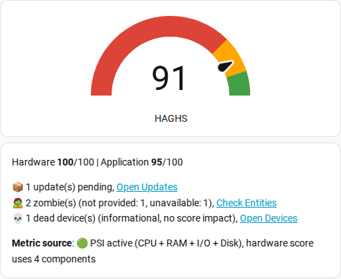
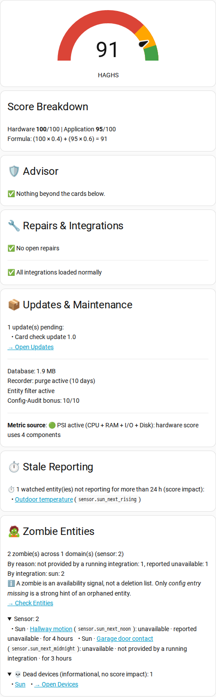

**The open standard for Home Assistant instance health monitoring.**

---

## Abstract
As Home Assistant matures into a mission-critical Smart Home OS, the need for a unified stability metric becomes paramount. **HAGHS** is a fully local, open-scoring framework designed to provide an objective **Health Score (0-100)**. It differentiates between transient hardware load and chronic maintenance neglect, providing users with a "North Star" for instance optimization. All scoring logic is fully visible in the codebase, no hidden penalties, no black boxes.

---

## Mission

- **Short-term:** Establish HAGHS as the community standard for Home Assistant instance health monitoring.
- **Long-term:** Propose HAGHS as a native HA Core feature, bringing unified health scoring to every Home Assistant installation by default. With user consent, HAGHS metrics should help the Home Assistant project understand how the software is being used and how healthy instances are across the ecosystem.

---
### Featured In
- [How-To Geek](https://www.howtogeek.com/this-tool-gave-my-home-assistant-server-a-rating-and-told-me-how-to-improve-it/) - *"This tool gave my Home Assistant server a rating (and told me how to improve it)"*
- [XDA Developers](https://www.xda-developers.com/tool-graded-home-assistant-server-told-how-make-better/) - *"This tool graded my Home Assistant server and told me how to make it better"*
- [SmartHütte Podcast](https://www.youtube.com/watch?v=G892ii7YTL8&t=48s) - Episode 30, at 0:48 (German)
- [HomeTech.fm Podcast](https://www.youtube.com/watch?v=IrIW2VR7qic&t=3676s) - Episode 569, at 1:01:16 (English)
- [Simon42 Youtube Video](https://www.youtube.com/watch?v=btd66ndsUuA) - Interview with D-N91, creator of HAGHS (German)
- [Tristans Smartes Heim Youtube Video](https://www.youtube.com/watch?v=oDUdchF1mww&t=20s) - Clean up your Home Assistant (German)
---

## Table of Contents
- [The HAGHS Standard](#the-haghs-standard)
- [Pillar 1: Hardware Performance (40%)](#pillar-1-hardware-performance-40)
- [Pillar 2: Application Hygiene (60%)](#pillar-2-application-hygiene-60)
- [Configuration](#configuration)
- [Label Configuration](#label-configuration-smart-whitelisting)
- [Sensor Attributes](#sensor-attributes)
- [Roadmap](#roadmap)
- [UI Integration](#ui-integration)
- [FAQ](#faq)
- [Changelog](#changelog)

**Detailed documentation**
- [Configuration and labels](https://github.com/HA-Pulse/home-assistant-global-health-score/blob/main/docs/configuration.md): every option, external databases, ignore labels, dynamic exclusions, pattern-based ignore, stale reporting
- [Sensor attributes](https://github.com/HA-Pulse/home-assistant-global-health-score/blob/main/docs/attributes.md): every attribute with type and meaning
- [Dashboard cards](https://github.com/HA-Pulse/home-assistant-global-health-score/blob/main/docs/cards.md): installation, entity ID, Lite vs. Pro
  - [Lite card YAML](https://github.com/HA-Pulse/home-assistant-global-health-score/blob/main/docs/cards/lite.yaml) · [Pro card YAML](https://github.com/HA-Pulse/home-assistant-global-health-score/blob/main/docs/cards/pro.yaml)
- [Release summaries](https://github.com/HA-Pulse/home-assistant-global-health-score/blob/main/docs/changelog.md): one summary per release

---

## The HAGHS Standard

The index is calculated via a weighted average of two core pillars, prioritizing long-term software hygiene over temporary hardware fluctuations.

### The Global Formula

$$Score_{Global} = \lfloor (Score_{Hardware} \cdot 0.4) + (Score_{Application} \cdot 0.6) \rfloor$$

*Note: We use **Floor Rounding** (Integer) to ensure a "Perfect 100" is only achieved by truly optimized systems. A penalty drops the score below 100 unless the Config-Audit bonus offsets it in the application pillar; zombies, open repairs and overdue watched entities always cap the application score at 99.*

---

## Pillar 1: Hardware Performance (40%)

Evaluates the physical constraints of the host machine using real system metrics. The hardware score is the average of all available component scores (CPU, RAM, I/O, Disk).

* **Metric Source (Smart Fallback):** HAGHS reads **Pressure Stall Information (PSI)** directly from the Linux kernel (`/proc/pressure/cpu`, `/proc/pressure/memory`, `/proc/pressure/io`). If PSI is unavailable, it automatically falls back to the manually configured CPU/RAM sensors. PSI measures real *stall time* (how long tasks waited for a resource), while classic sensors measure *utilization* (how busy a resource is). Because these scales differ fundamentally, HAGHS uses **separate threshold tiers** for each source.

<b>Penalty tier tables</b> - exact thresholds for CPU, RAM, and I/O

* **CPU Load (Tiered):**

  | | Classic Sensor (Utilization) | PSI (Stall Time) |
  |---|---|---|
  | No penalty | 0–25% | 0–5% |
  | Light (10 pts) | 26–40% | 6–15% |
  | Medium (25 pts) | 41–60% | 16–30% |
  | Heavy (50 pts) | 61–80% | 31–50% |
  | Critical (80 pts) | >80% | >50% |

* **Memory Pressure (Tiered):**

  | | Classic Sensor (Utilization) | PSI (Stall Time) |
  |---|---|---|
  | No penalty | 0–69% | 0–5% |
  | Gradual ramp | 70–89% (linear) | — |
  | Light (10 pts) | — | 6–10% |
  | Medium (25 pts) | — | 11–25% |
  | Heavy (50 pts) | — | 26–40% |
  | Critical (80 pts) | ≥90% | >40% |

* **I/O Pressure (PSI-only):** Only available on systems with PSI support. Measures disk/storage stall time.

  | | PSI I/O (Stall Time) |
  |---|---|
  | No penalty | 0–5% |
  | Light (10 pts) | 6–15% |
  | Medium (25 pts) | 16–30% |
  | Heavy (50 pts) | 31–50% |
  | Critical (80 pts) | >50% |

  > When PSI I/O is available, the hardware score uses **4 components** (CPU + RAM + I/O + Disk) / 4. Without I/O, it falls back to **3 components** (CPU + RAM + Disk) / 3. Without PSI, a CPU or RAM value whose sensor is not selected is **not measured** and left out of the average (never counted as 0 % load); `cpu_ram_source` and `rec_cpu_ram_unmeasured` show it.

**PSI-aware recommendations:** The advisor text is split into PSI and classic variants for CPU and RAM. On PSI-equipped systems you see "PSI CPU stall time is impacting score (12.5%)" (the actual blocking time); on fallback systems "CPU utilization is impacting score (65.0%)" (the busy-ness). The metric source is always explicit so you know whether you are looking at stalls or load.

**Translatable recommendations:** The advisor texts are translatable. English is built in as the fallback; a `translations/<language>.json` file can override any template, and missing keys automatically fall back to English. Translations: English (built in), Brazilian Portuguese, German.

**Power supply detection (Raspberry Pi):** HAGHS auto-detects `binary_sensor.rpi_power_status` when available and applies a flat **20-point** hardware penalty while under-voltage is reported.

* **Storage Integrity (Smart Thresholds):** Disk usage is **auto-detected** via `psutil`, no manual sensor needed. Thresholds adapt to your storage type:
  * **SD-Card / eMMC:** Critical at **<3 GB free**, Warning at **<5 GB free**.
  * **SSD:** Warning at **<10% free** space.

---

## Pillar 2: Application Hygiene (60%)

Measures "maintenance debt", the hidden factors that cause sluggishness, failed backups, and slow restarts. Every point difference below 100 is explained: each deduction and each unearned bonus prints a recommendation line and sets a matching `rec_*` flag.

* **Zombie Entities (Ratio-based, max 20 pts, hard-cap at 99):** Detects entities with `unavailable` or `unknown` state in 22 physical/UI-relevant domains (automations, scripts, etc. are excluded). Penalties scale with the percentage of zombies relative to the entities in the monitored domains. Two **configurable grace periods** prevent false positives: a regular window (default **5 min**) for all zombie-eligible entities and an extended window (default **60 min**) for `device_class: battery`. Both are adjustable in the Options Flow (1–240 min each). **Disabled** entities are silently ignored - disabling an entity in HA is an alternative to applying an ignore label. While at least one zombie is reported, the application score is **hard-capped at 99** so the Config-Audit bonus can never mask a real zombie. The `zombie_entities` attribute lists up to **100** entries (the recorder's 16 KB attribute limit). Entities without an entity-registry entry (YAML-defined templates, Utility Meter, Riemann Sum, ...) are **not** zombies: when they are `unavailable` or `unknown` past the grace period in the monitored domains, they are reported separately as *unregistered* (`unregistered_count`, `unregistered_entities`, `unregistered_count_per_domain`) and do **not** affect the score. `zombie_count` and `zombie_count_per_domain` always carry the full totals. A zombie is an availability signal, not proof that an entity is orphaned, unused or safe to delete: a temporary outage, an idle device or an entity that only reports in some operating modes looks the same. Before deleting an entity, check its integration, device and config entry. When `zombie_count` is higher than the 100 listed entries, `zombie_count_per_domain` and `zombie_count_per_integration` show where the rest come from.
  
* **Dead Devices (informational, no score impact):** Flags devices only when all monitored entities in `ZOMBIE_DOMAINS` are `unavailable` beyond their respective grace periods. `unknown` does not count as an outage, and entities outside the monitored domains are excluded. Devices without monitored entities are not flagged. Reported via `dead_device_count`, `dead_devices` and the `rec_dead_devices` flag. Entity-level zombie points stay authoritative, so no second penalty is added. A dead device is hidden only when all of its monitored entities are ignored (device label, or every entity by label or pattern).

* **Empty Devices (informational, no score impact):** Flags devices that have no entity at all in the entity registry (disabled entities included), using Home Assistant facts only: the device is not disabled, not a service entry, no other device is connected through it (hubs and bridges are skipped), and its config entry is loaded. Typical leftovers after removing or re-pairing a device. Respects ignore labels on the device and its area; nothing is checked before the zombie grace period has passed after a restart. Reported via `empty_device_count`, `empty_devices` and the `rec_empty_devices` flag (#93).

* **Database Hygiene (Dynamic Limit):** Database size is **auto-detected** for the built-in SQLite database, no manual FileSize sensor or YAML needed. For **external databases** (MariaDB, PostgreSQL), you can configure a custom database size sensor in the setup or options menu (see [External Database](https://github.com/HA-Pulse/home-assistant-global-health-score/blob/main/docs/configuration.md#external-database-mariadb)). The limit scales with your system: `Limit_MB = 1000 + (Total_Entities × 2.5)`. Example: 200 entities = 1.5 GB limit. Above the limit the database costs **10 pts**, above 2.5 times the limit **30 pts**.
  
* **Updates & Core Age:** Tracks pending updates and lists them by name (e.g., `pending_updates: ["ESPHome 2024.2"]`). Pending updates only contribute to the penalty after HAGHS has seen them pending for **7 days**, counted from the first time HAGHS saw that version offered, also across restarts; a newer offered version starts its own 7 days. The list shows them immediately, only the score is delayed. Each grace-aged update costs **5 pts**, Core lag (≥3 months) adds **20 pts**, capped at **35 pts** total. Update entities respect the same ignore labels and patterns as zombie detection; disabled update entities are excluded automatically.
  
* **Integration Health:** Natively detects integrations stuck in `SETUP_ERROR`, `SETUP_RETRY`, or `FAILED_UNLOAD` via HA's ConfigEntry API. Penalty: **5 pts per unhealthy config entry**, capped at **15 pts**. The affected entries are counted in `integration_unhealthy_count` and reported in the recommendations.
  
* **Repairs:** Open repair issues from HA's issue registry cost **5 pts each**, capped at **10 pts**. Counted are only issues that are currently active, not dismissed and owned by another integration; repairs raised by HAGHS itself describe the integration's own prerequisites and are excluded. While any repair is open, the application score is **hard-capped at 99** - the Config-Audit bonus can never mask a broken integration. Count and list are exposed as `repair_count` and `repairs`, the flag is `rec_repairs`. To take a repair out of the score, use HA's native **"Ignore"** action on it (Settings > Repairs); no HAGHS option is needed. Note that a broken backend often raises a repair issue *and* leaves its config entry unhealthy, so one root cause can cost up to **25 pts** together (15 integration health + 10 repairs).
  
* **Backup Health:** A static **30-point deduction** for stale backups.
  
* **Config Audit (Bonus):** Awards up to **+10 points** for good recorder hygiene: a recorder retention of at most 10 days, Home Assistant's default (+5), and a user-set include/exclude entity filter (+5). Unearned bonus points are reported in the recommendations and in `rec_config_audit` (meaning "bonus points are missing", not "the configuration is bad").

---

## Configuration

> **Short version.** Every option, the integration-entry exclusion and the external database setup are in [docs/configuration.md](https://github.com/HA-Pulse/home-assistant-global-health-score/blob/main/docs/configuration.md).

HAGHS is installed via **HACS** and configured via the **UI**

### 1. Prerequisites

Install the built-in [**System Monitor**](https://www.home-assistant.io/integrations/systemmonitor/) integration via **Settings > Devices & Services > Add Integration** and search for "System Monitor". This is a **native HA integration**, it is not available in HACS.

After adding it, navigate to its entity list and **manually enable** the processor and memory usage entities (they are disabled by default), for example:
* `sensor.system_monitor_processor_use` (Percentage %)
* `sensor.system_monitor_memory_usage` (Percentage %)

> **Note:** Where the Linux kernel provides PSI (usually HAOS and Supervised), HAGHS uses it automatically and these sensors are only a safety net. They are optional in the setup flow; without PSI the System Monitor sensors are suggested when HAGHS finds them, but HAGHS never selects them by itself.
> > **Without PSI and without these sensors:** HAGHS still sets up and keeps running. CPU and/or RAM are left out of the hardware score, a recommendation line says so, and a non-blocking **Repair** in *Settings > System > Repairs* lets you pick the missing sensor (System Monitor's processor and memory sensors are pre-filled when found; both fields are optional, an empty field keeps its setting). Submitting it includes them without restarting Home Assistant.

**That's it.** Database size and disk usage are detected automatically. No `configuration.yaml` changes needed.

### 2. Installation & Setup
1.  Download **HAGHS** in **HACS** and **Restart Home Assistant**.
2.  Go to **Settings > Devices & Services > Integrations > Add Integration** and search for **HAGHS**.
3.  Follow the setup mask: CPU and RAM sensors (only used without PSI), storage type, ignore labels and patterns, optionally a database size sensor for an external database.

Change any of it later in **Settings > Devices & Services > Integrations > HAGHS > Configure**; changes apply immediately, no restart required.

[All configuration options →](https://github.com/HA-Pulse/home-assistant-global-health-score/blob/main/docs/configuration.md)

---

## Label Configuration (Smart Whitelisting)

> **Short version.** Label tips, conditional ignore labels, automations, pattern-based ignore and stale reporting are in [docs/configuration.md](https://github.com/HA-Pulse/home-assistant-global-health-score/blob/main/docs/configuration.md#label-configuration-smart-whitelisting).

To prevent false positives from sleeping tablets or seasonal devices, you have three ways to exclude entities from HAGHS scoring - pick whichever feels most natural:

1. **Disable the entity** (*Settings > Devices & Services > Entity > Disable entity*). HAGHS respects `entity_registry.disabled_by` automatically, so disabled entities never count as zombies or contribute to update penalties. No HAGHS configuration needed.
2. **Apply an ignore label** (described below) for entities you want to keep enabled but exclude from scoring (e.g. vacation devices, tablets that sleep).
3. **Use a glob pattern** (see [Pattern-Based Ignore](https://github.com/HA-Pulse/home-assistant-global-health-score/blob/main/docs/configuration.md#pattern-based-ignore-for-entities-without-a-unique-id)) for entities without a unique ID, which cannot carry a label.

To use ignore labels:
1.  Go to **Settings > Areas, labels & zones > Labels**.
2.  The `haghs_ignore` label is created automatically during setup. Create additional labels if needed (e.g. `vacation`, `guest_mode`).
3.  Open **Settings > Devices & Services > HAGHS > Configure** and add every label you want HAGHS to honour to the **Ignore labels** field. The field accepts a list, so all listed labels are evaluated.
4.  Assign any of those labels to any **Area**, **Device**, **Entity**, or **Update Entity**. A device label covers all of its entities.

[All label options →](https://github.com/HA-Pulse/home-assistant-global-health-score/blob/main/docs/configuration.md#label-configuration-smart-whitelisting)

---

## Sensor Attributes

> **Short version.** The full list of all attributes with types and meaning is in [docs/attributes.md](https://github.com/HA-Pulse/home-assistant-global-health-score/blob/main/docs/attributes.md).

The most used attributes for dashboard cards, automations, and templates:

| Attribute | Type | Description |
|---|---|---|
| `hardware_score` | int | Hardware pillar score (0–100): average of the measured components (CPU, RAM, I/O when PSI provides it, Disk) minus 20 points on RPi under-voltage |
| `application_score` | int | Application pillar score (0–100) |
| `recommendations` | string | Advisor recommendations (CPU, RAM, I/O, disk, DB, power, updates, zombies, dead and empty devices, stale reporting, backup, core lag, integration health, config audit, repairs, calculation warnings) |
| `zombie_count` | int | Total number of zombie entities (unavailable/unknown past the grace period, with an entity-registry entry) |
| `zombie_entities`| list | Entity IDs of zombies (capped at 100; `zombie_count` carries the full total); current only, excluded from recorder history (`zombie_count` stays in the history) |
| `zombie_reasons` | dict | Reason per listed zombie (same 100 entries and order as `zombie_entities`), from Home Assistant facts only, first match in this order: `config_entry_missing` (the config entry the entity belonged to no longer exists; **the only strong hint of an orphaned entity**), `integration_not_loaded` (the entry exists but is not loaded; fix the integration, not a reason to delete), `not_provided` (HA only restored the stored state because no running integration provides the entity; not a reason to delete without checking), `unavailable` (the integration runs and reports the entity as unavailable/unknown, often temporary; not a reason to delete); current only, excluded from recorder history |
| `pending_updates` | list | Names of pending updates (e.g., `["ESPHome 2024.2"]`). Listed immediately; only counted toward the score after HAGHS has seen that version pending for 7 days (also across restarts); current only, excluded from recorder history (`rec_updates_pending` stays in the history) |
| `repair_count` | int | Number of open repair issues counted toward the score (own domain and dismissed issues excluded) |
| `integration_unhealthy_count` | int | Number of config entries in `SETUP_ERROR`, `SETUP_RETRY`, or `FAILED_UNLOAD` (source of the Integration Health penalty) |
| `db_size_mb` | float | Current database size in MB (auto-detected for SQLite, or from external DB sensor if configured) |
| `psi_available` | bool | `True` when PSI provides both CPU and memory data. I/O PSI is read independently and may still be present when this is `False`. Disk is always read via `psutil`, never PSI. |
| `cpu_ram_source` | str/null | Where CPU and RAM come from: `psi`, `sensors` (both measured, at least one by a selected sensor), `partial` (one not measured), `none` (neither measured; no PSI and no sensor selected). Not measured values are left out of the hardware score. `null` while the hardware pillar has no measurement (first failed update, hardware fallback). |
| `stale_watch_count` | int | Complete count of overdue directly labelled watched entities in any domain |

[All attributes →](https://github.com/HA-Pulse/home-assistant-global-health-score/blob/main/docs/attributes.md)

---

## Roadmap

Planned features, declined items, and completed milestones live in [`ROADMAP.md`](https://github.com/HA-Pulse/home-assistant-global-health-score/blob/main/ROADMAP.md). The roadmap follows the HAGHS philosophy: local-only, system-health focus, HA Core compatibility.

---

## UI Integration

> **Short version.** Installation, entity ID and the Lite vs. Pro comparison are in [docs/cards.md](https://github.com/HA-Pulse/home-assistant-global-health-score/blob/main/docs/cards.md).

HAGHS provides all data as sensor attributes; two ready-to-use dashboard cards show them. Both are wired to `sensor.system_ha_global_health_score`.

**HAGHS Lite v1.4 (Quick Check):** a compact card for a fast overview, score, sub-scores, and actionable links. Configuration: [docs/cards/lite.yaml](https://github.com/HA-Pulse/home-assistant-global-health-score/blob/main/docs/cards/lite.yaml).

**HAGHS Pro v1.4 (Command Center):** a comprehensive dashboard with full score breakdown, grouped zombies, database monitoring, recorder health, and deep-links. Configuration: [docs/cards/pro.yaml](https://github.com/HA-Pulse/home-assistant-global-health-score/blob/main/docs/cards/pro.yaml).

[All card details →](https://github.com/HA-Pulse/home-assistant-global-health-score/blob/main/docs/cards.md)

---

## FAQ

**Why do I still see zombies or Repairs after excluding an integration entry?**

The integration-entry exclusion only changes Integration Health. It does not suppress entity or device detection, update checks or Repairs. Review those findings separately and use their existing exclusion or ignore mechanisms where appropriate.

**How do I hide entities during a vacation without Spook?**

Use the **Conditional ignore labels** with a helper such as `input_boolean.vacation_mode`. While the helper is `on`, the labels act as ignore labels; switch it from your vacation automation. Details in [Dynamic exclusions via automation](https://github.com/HA-Pulse/home-assistant-global-health-score/blob/main/docs/configuration.md#dynamic-exclusions-via-automation).

**Can I delete all zombie entities?**

No, not without checking them. A zombie only means that the entity has been `unavailable` or `unknown` for longer than the grace period. That also happens during a temporary outage, for an idle device or for an entity that only reports in some operating modes. Check the entity's integration, device and config entry before deleting it; for entities you want to keep, use an ignore label or disable them. With more than 100 zombies, `zombie_count_per_integration` shows which integration they come from. `zombie_reasons` tells you why each one is listed: only `config_entry_missing` is a strong hint of an orphaned entity; `integration_not_loaded`, `not_provided` and `unavailable` are no reason to delete.

**Why is my score so low?**
Check the Advisor recommendations in the dashboard card. They tell you exactly where penalties come from (e.g., "5 update(s) pending", "Stale backup detected").

**Does HAGHS send any data to external servers?**
No. All data collection is strictly local. HAGHS reads directly from Linux kernel interfaces (`/proc/pressure/*`), `psutil`, and the HA internal state machine. No outbound network traffic is ever initiated by this integration.

**Does HAGHS work with Docker / Kubernetes?**
Yes. HAGHS reads disk usage via `psutil` and the database size from the SQLite file or the configured sensor. The Core update entity is detected dynamically, no Supervisor dependency.

**How does PSI work and why does HAGHS use it?**
[PSI (Pressure Stall Information)](https://docs.kernel.org/accounting/psi.html) is a Linux kernel feature that measures how long tasks wait for CPU, memory, or I/O, rather than how busy a resource is. HAGHS uses PSI as the primary metric where available, falling back to classic utilization sensors on systems without PSI support. Because their scales differ fundamentally, HAGHS uses separate penalty thresholds for each. When PSI is active, I/O monitoring is also included, giving a 4-component hardware score (CPU + RAM + I/O + Disk). Without PSI, the score averages Disk with the CPU and RAM values that have a sensor selected (1 to 3 components). The classic sensors selected during setup are only used when PSI is unavailable.

**I use an external database (MariaDB / PostgreSQL). How do I monitor it?**
See [External Database](https://github.com/HA-Pulse/home-assistant-global-health-score/blob/main/docs/configuration.md#external-database-mariadb) for full setup instructions. The sensor must report the database size in **MB**. Without a sensor HAGHS measures `home-assistant_v2.db` in the config folder; only when that file does not exist is the database part neutral. A leftover SQLite file from before the switch is still measured.

**Do I still need a disk usage sensor?**
No. HAGHS reads disk usage directly via `psutil`. No manual sensor selection required.

**How are update penalties calculated?**
Each update whose offered version HAGHS has seen pending for at least 7 days (also across restarts) costs **5 pts**. A Core version lag (≥3 months behind) adds **20 pts**. The combined penalty is capped at **35 pts**.

**How does the zombie grace period work?**
Entities that just became `unavailable` or `unknown` are ignored for **5 minutes by default**, configurable in the Options Flow from 1 to 240 minutes. This prevents your score from dropping during brief network hiccups or device reboots. Battery-class entities (`device_class: battery`) get a separate, longer window (default 60 minutes).

**Why is my score capped at 99 right after a restart?**
A cap at 99 means a zombie, an open repair or an overdue watched entity is reported; the Config-Audit bonus can never lift it to 100. A restart itself does not create zombies: HAGHS uses `max(last_changed, boot_time)` as the floor for the grace window, so states restored from the recorder still get the full grace window, and zombie detection waits for `EVENT_HOMEASSISTANT_STARTED` before its first run.

**Do I need to remove and re-add HAGHS after an update?**
No. Config entries of every older version (1.x, 2.x, 3.0–3.3) are migrated to the current layout automatically on the next restart, also for users who saw the *"Migration handler not found"* warning on v2.2.x (#75).

**Why did my score change after an update?**
The [release summaries](https://github.com/HA-Pulse/home-assistant-global-health-score/blob/main/docs/changelog.md) list the behavior changes per release; v2.3.0 and v2.4.0 include upgrade notes. The recommendations and `rec_*` flags show which factors cost points right now.

**A pending update from yesterday is in the list but doesn't change my score yet — why?**
Because of the 7-day update grace period. The list is informational and shows every pending update that is not ignored or disabled; the **score** only deducts after HAGHS has seen that version pending for at least 7 days, also across restarts.

**Can I change the update interval?**
Yes. Go to **Settings > Devices & Services > Integrations > HAGHS > Configure** and adjust the update interval (10–3600 seconds). Lower values give faster updates, higher values save resources.

**What happens if a sub-calculation fails?**
HAGHS wraps the whole update cycle in a safety net: a pillar that fails or times out (time limit 10 seconds) falls back to a neutral score (100 / no penalty) for that refresh and the failure is logged, so the sensor keeps updating. If a failure happens outside the two guarded pillars, the **last valid result is kept** instead, and only before the first successful update is a fully neutral result returned.

---

## Changelog

> **Short version.** A summary of every release is in [docs/changelog.md](https://github.com/HA-Pulse/home-assistant-global-health-score/blob/main/docs/changelog.md).

Every change in detail: [v2.4.0_CHANGELOG.md](https://github.com/HA-Pulse/home-assistant-global-health-score/blob/main/v2.4.0_CHANGELOG.md) (active changelog) and [v2.3_CHANGELOG.md](https://github.com/HA-Pulse/home-assistant-global-health-score/blob/main/v2.3_CHANGELOG.md) (all changes up to v2.3.0).

[All release summaries →](https://github.com/HA-Pulse/home-assistant-global-health-score/blob/main/docs/changelog.md)

---

**AI Disclosure:** While the architectural concept and logic are my own, I utilized AI to assist with code optimization and documentation formatting.
