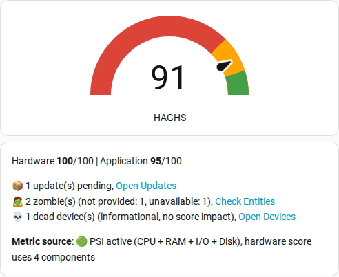
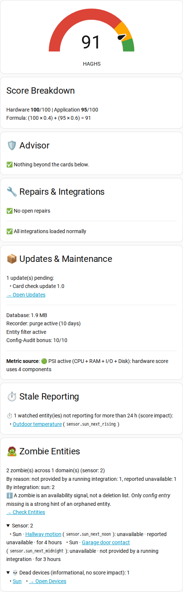

[← Back to the README](https://github.com/HA-Pulse/home-assistant-global-health-score/blob/main/README.md)

# Dashboard cards

Installation, entity ID and the Lite vs. Pro comparison. The card configurations are [docs/cards/lite.yaml](https://github.com/HA-Pulse/home-assistant-global-health-score/blob/main/docs/cards/lite.yaml) and [docs/cards/pro.yaml](https://github.com/HA-Pulse/home-assistant-global-health-score/blob/main/docs/cards/pro.yaml): open the file, copy its content into a manual card (Edit dashboard → Add card → Manual; see the [dashboard docs](https://www.home-assistant.io/dashboards/cards/)).

## UI Integration

HAGHS provides all data as sensor attributes. Dashboard visualization happens entirely in Lovelace, keeping a clean separation between backend (sensor) and frontend (UI).

Below are two ready-to-use card configurations:

Both configurations are wired to the entity ID `sensor.system_ha_global_health_score`. If your sensor has a different ID (the ID comes from the sensor name "System: HA - Global Health Score"; it differs when you renamed the entity or another entity already had that ID), replace it everywhere it appears: the `entity:` line of the gauge card and the `` line at the top of each markdown card.

On older Home Assistant versions (tested: 2024.10) a link to a single entity opens the Entities page, but not that entity's more-info dialog; on the newer versions checked in a browser before each release (2026.9 to 2026.11) it opens the dialog directly. All other card links behaved the same on all checked versions.

### HAGHS Lite v1.4 (Quick Check)

A compact card for a fast overview, score, sub-scores, and actionable links.

Configuration: [docs/cards/lite.yaml](https://github.com/HA-Pulse/home-assistant-global-health-score/blob/main/docs/cards/lite.yaml)

### HAGHS Pro v1.4 (Command Center)

A comprehensive dashboard with full score breakdown, grouped zombies, database monitoring, recorder health, and deep-links.

Configuration: [docs/cards/pro.yaml](https://github.com/HA-Pulse/home-assistant-global-health-score/blob/main/docs/cards/pro.yaml)

### Lite vs. Pro Comparison

| Feature | Lite | Pro |
|---|:---:|:---:|
| Gauge with score | Yes | Yes |
| Hardware / Application score | One line | One line + live formula |
| Calculation failure (failed pillar, failed update cycle) | Status line | Status line |
| Conditional ignore labels active | No | Status line |
| Advisor recommendations (CPU, RAM, I/O, ...) | Inline | Dedicated card |
| Pending updates (by name) | Count + link | Full list + deep-link |
| Stale backup | Status line + link | Status line + link |
| Zombie details | Count by reason + link | Grouped by domain, reason and "for" per entity, breakdown by reason and integration |
| Stale reporting (watched and passive) | Advisor line (watched only) | Watched list with a link per entity, passive list expandable |
| Repairs & unhealthy integrations | Count + link | Count + list + deep-link per integration |
| Dead devices (informational) | Count + link | Expandable list, link per device |
| Empty devices (informational) | Count + link | Expandable list, link per device |
| Unregistered entities (informational) | No | Expandable list, link per entity |
| Config-Audit bonus (earned) | No | Yes |
| Database size + warning | Warning line | Yes |
| Recorder health (purge + filter) | Tips + docs link | Yes + docs link |
| Metric source (PSI vs. Classic, CPU/RAM not measured) | Yes (detailed) | Yes (detailed) |
| Deep-links to HA settings | Yes | Yes |
